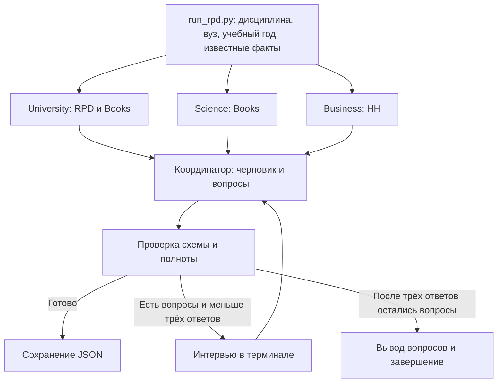

# Как работает генератор РПД

Это снимок проверки терминального пайплайна. Для текущего интерфейса Streamlit и его запуска откройте [инструкцию веб-приложения](WEB_APP.md).

Проверка от 19 ноября 2026 года. Сейчас проект запускается из терминала. Основной результат — черновик рабочей программы одной дисциплины в JSON. Комплект по курсу запускается через `run_course.py`, подборка свежих ИТ-исследований — через `run_science.py`.

## 1. Подготовка РПД



### Ввод и запуск графа

1. Команда `run_rpd.py` принимает название дисциплины, целевой учебный год и вуз. Значения задаются аргументами или вводятся в терминале. Параметр `--facts-file` принимает файл UTF-8 с известными сведениями, например из учебного плана. Pydantic проверяет входные данные. Для текста фактов установлен предел 16 000 символов.
2. Приложение загружает настройки из `.env`, открывает клиент Yandex AI Studio через библиотеку `openai` и создаёт граф с уникальным идентификатором запуска. Для РПД необходимы доступ к модели координатора и идентификатор индекса RPD. Индексы Books и HH подключаются при наличии настроек. Профильные узлы по умолчанию используют Alice AI LLM Flash. URI модели координатора и каждого узла можно задать отдельно.
3. LangGraph запускает три профильных узла параллельно. Каждый работает со своей инструкцией и своими поисковыми запросами. Узлы используют существующие индексы Yandex Vector Store напрямую через API.

### Источники и зоны ответственности

| Узел | Поиск | Что извлекает |
| --- | --- | --- |
| University | До 6 фрагментов из RPD и до 3 из Books | Из вузовских материалов — направления, трудоёмкость, компетенции, семестры, темы и формы аттестации. Из Books — учебники и библиография. |
| Science в графе РПД | До 3 фрагментов из Books | Книги, научные материалы, понятия и методы по дисциплине. |
| Business | До 3 фрагментов из HH | Навыки, инструменты и примеры практических задач из вакансий. |

В координатор могут попасть имя файла, имя индекса, до 2 000 символов каждого фрагмента и краткие наблюдения специалистов. Наблюдение ссылается на один из возвращённых фрагментов. Код пропускает пустые наблюдения и ссылки за пределами списка, оставляет до четырёх наблюдений на узел. При недоступности Books или HH поиск по остальным источникам продолжается. Ошибка запроса к обязательному RPD останавливает запуск. При явном отказе модели или фильтрации Yandex граф пропускает материалы соответствующего узла и продолжает с оставшимися источниками.

### Координатор, схема и интервью

1. Координатор получает пользовательские факты, отчёты и фрагменты источников. На следующих проходах он также получает предыдущий черновик и историю ответов. Инструкция просит сверять вуз, программу, дисциплину и год, отдавать приоритет подтверждённым фактам пользователя и запрашивать уточнение при расхождениях. Вакансии и книги используются для тем, литературы и примеров. Правила отбора фактов в этой части заданы промптом.
2. Yandex Responses API получает строгую схему ответа, собранную из `final_schema.json`. Ответ содержит `document` и `questions`. Во временной схеме ответа для неизвестных необязательных полей предусмотрен `null`. Приложение убирает такие свойства из объектов, подставляет из запроса название, вуз и учебный год и проверяет результат по полной схеме Draft 2020-12. При ошибке разбора JSON или нарушении схемы координатор получает одну попытку исправить ответ за проход.
3. После проверки типов граф ищет значения `Netu` и проверяет наличие направления, целей или задач, компетенций, суммарных часов и ЗЕТ и тем по семестрам. Он объединяет вопросы программы и модели, убирает точные повторы и отбрасывает строки модели без букв. Допустимые вопросы модели ограничены шестью за один проход. Вопросы программы могут дополнять этот список.
4. При наличии вопросов LangGraph вызывает `interrupt()`. Сейчас их видит человек, запустивший команду, и отвечает одним сообщением в том же терминале. Ответ возобновляет тот же граф. Поиск по индексам повторно не запускается. Состояние хранится в памяти процесса. Если после трёх ответов остались вопросы, программа выводит их и закрывает запуск без JSON.
5. При успешной проверке программа записывает UTF-8 JSON в `rpd_draft.json` или по адресу из `--output`. Каждый файл содержит одну РПД. Существующий файл защищён от перезаписи.

### Из чего состоит JSON

В `final_schema.json` описаны метаданные, дисциплина, массив направлений `programs`, цели и задачи, компетенции с индикаторами, часы и ЗЕТ, тематический план, аттестация, оценочные материалы, литература и материально-техническое обеспечение. Схема также поддерживает электронную подпись, замечания об исходниках (`sourceNotes`), практическую подготовку внутри темы и подробные оценочные материалы. Даты и ссылки могут храниться строками в исходном формате. Результат приложения всегда помечен типом «рабочая программа дисциплины», хотя сама схема охватывает и другие учебно-методические документы.

Проверка по схеме подтверждает структуру и типы. Полноту граф проверяет отдельными правилами. Например, направление считается заполненным, если найден код или название. Код пока не сверяет суммы часов, актуальность источников и официальность компетенций, обязательной формы аттестации или утверждения документа. Он также не записывает для каждого поля ссылку на подтверждающий источник. Поэтому готовый JSON остаётся черновиком для методической проверки.

## 2. Комплект РПД на курс или программу

У команды `run_course.py` два режима:

- **По названию.** Пользователь указывает курс или образовательную программу, вуз и целевой учебный год. Если нужен определённый год обучения, например второй курс бакалавриата, передаёт `--study-year 2`. Команда ищет материалы учебного плана в RPD и темы в Books. Модель предлагает перечень дисциплин и несколько тем для каждой. Команда показывает материалы для сверки, если модель сослалась на найденные фрагменты RPD. Остальные позиции помечаются как предложения. Пользователь подтверждает перечень в терминале. Подтверждение разрешает начать подготовку черновиков.
- **По списку.** Пользователь передаёт `--disciplines-file` с одним названием на строку в UTF-8. Поиск состава курса пропускается. Пустые строки и точные дубли с учётом регистра и пробелов убираются. К закреплённому списку можно передать `--facts-dir` с файлами `01.txt`, `02.txt` и далее по порядку списка после удаления дублей. Приложение использует эти файлы как исходные сведения для отдельных дисциплин.

Для каждой позиции последовательно запускается тот же граф, что для одиночной РПД. При необходимости в терминале открывается интервью именно по этой дисциплине. Темы, предложенные при поиске курса, идут в граф с пометкой для обсуждения. Исходные учебные материалы, год курса, часы, компетенции и аттестация подлежат сверке по каждой дисциплине отдельно.

Новая папка комплекта содержит:

| Файл | Содержимое |
| --- | --- |
| `course.txt` | Название курса, вуз и год, все дисциплины, статус каждой РПД. Для готовых РПД указаны цели, нагрузка, темы по семестрам и имена файлов. |
| `01-rpd.json`, `02-rpd.json`, … | Отдельные документы, прошедшие проверку по `final_schema.json`. |
| `01-rpd.txt`, `02-rpd.txt`, … | Читаемое представление каждого сохранённого JSON с названиями разделов и полей на русском. |

Общий отчёт обновляется после обработки каждой дисциплины. Если одна РПД осталась без результата, следующая дисциплина всё равно обрабатывается. Прерывание интервью завершает запуск и оставляет уже созданные файлы. При неполном комплекте код возврата ненулевой.

Поисковая выдача ограничена загруженными индексами. Актуальность тем оценивается по найденным материалам и подтверждению пользователя. Связь всех дисциплин с действующей версией официального учебного плана автоматически пока не проверяется. Например, при проверке «Фундаментальной информатики» приложение предложило алгоритмы и структуры данных, технологии баз данных и машинное обучение, но точный утверждённый перечень для ЮФУ на 2026/2027 в этом запросе не подтверждён.

## 3. Отдельный сценарий Science

1. `run_science.py` ищет публикации за последние 365 дней. Есть пять областей: `ai`, `data`, `security`, `systems`, `software`. Параметр `--area` ограничивает поиск одной областью. Без него проверяются все пять.
2. Crossref возвращает метаданные статей из заданного в коде набора журналов и сборников. Ранжирование использует счётчик цитирований Crossref. arXiv добавляет недавние препринты из выбранных категорий информатики. Подборка содержит до пяти карточек. Код устраняет повторы по DOI и названию и старается охватить несколько областей при общем поиске.
3. Оператор может перечислить проверенные экспертом DOI в `SCIENCE_VERIFIED_DOIS`. Для найденных в Crossref работ из этого списка приложение проверяет уведомления об отзыве. В обнаруженном случае отзыва карточка и её копия из arXiv исключаются. Если проверить уведомление не удалось, карточка остаётся кандидатом. Для отправки модели нужны и ручное подтверждение, и успешная проверка Crossref без найденного отзыва.
4. При включённой настройке Semantic Scholar может дополнить показанные в терминале карточки счётчиком цитирований. Подборка формируется до этого запроса, так что Semantic Scholar не влияет на её порядок. Популярность по цитированиям и статус рецензирования проверяются отдельно.
5. Только подтверждённые карточки передаются модели Science для краткого обзора. В них есть библиографические сведения и ссылки. Полные тексты, аннотации и счётчики цитирований в запрос к модели не входят. Этот поиск работает по API во время запуска. Загружать каталог статей в векторное хранилище для него не требуется, а результаты подбора не передаются координатору РПД.

## 4. Проверки

| Проверка | Результат |
| --- | --- |
| Python 3.11.9 и зависимости | `pip check` прошёл. |
| Модель Yandex через Responses API | Тестовый запрос завершился успешно. |
| Индекс RPD | 204 из 204 файлов готовы. В живом поиске University получила до 6 фрагментов по дисциплине «Базы данных». |
| Индекс Books | Готов 81 файл из 118, 36 в обработке, 1 с ошибкой. Прямой поисковый запрос вернул три фрагмента. Результаты поиска надо отдельно оценивать на релевантность. |
| Индекс HH | Готов 1 файл из 17, 16 в обработке. Узел Business получил три фрагмента. Один готовый файл может дать несколько фрагментов. |
| Отчёты профильных узлов | Science и Business сформировали наблюдения. У University тестовая сводка была прервана фильтром Yandex. После исправления её материалы исключаются из запроса координатору. |
| Science, `--area data` | Реальные Crossref и arXiv вернули четыре опубликованных кандидата и один препринт. В этой подборке не было подтверждённого DOI. |
| Semantic Scholar и обзор подтверждённых статей | Реальный запрос Semantic Scholar не запускался. Отбор по DOI, исключение отзыва и разделение библиографических данных со счётчиками проверены на тестовых ответах. |
| Подбор дисциплин для курса | Реальный запрос по «Фундаментальной информатике» с RPD и Books предложил восемь дисциплин и темы. На этапе сверки генерация комплекта из всей подборки не запускалась. |
| Генерация, интервью и сохранение | Первый живой прогон дошёл до уточнений и завершился с неполным ответом модели. После уточнения промпта пакетный прогон на вымышленных данных по дисциплине «Базы данных» сохранил JSON, TXT и общий отчёт. Итоговый JSON независимо проверен по Draft 2020-12. Повторный запуск с явным ограничением вопросов существенными пропусками завершился без интервью. |
| Локальные проверки | Восемь тестов прошли. Проверены схемы, маршруты индексов, исправление формата, интервью, модерация, сборка JSON/TXT, частичный комплект и правила допуска статей в обзор Science. |

Счётчики индексов приведены на момент проверки. Код диагностики возвращает `1`, если обработаны не все файлы, даже когда тестовый поиск по выбранному индексу работает.

## 5. Как повторить проверки

В PowerShell из папки проекта с установленными зависимостями и заполненным локальным `.env`:

```powershell
.\.venv\Scripts\python.exe -m pip check
.\.venv\Scripts\python.exe -m unittest discover -s tests -v
.\.venv\Scripts\python.exe check_yandex_indexes.py --check-model
.\.venv\Scripts\python.exe check_yandex_indexes.py --index rpd --query "Базы данных"
.\.venv\Scripts\python.exe check_yandex_indexes.py --index books --query "Базы данных SQL"
.\.venv\Scripts\python.exe run_science.py --area data
```

Для запуска РПД подготовьте `facts.txt` в UTF-8 и выберите свободное имя для результата:

```powershell
.\.venv\Scripts\python.exe run_rpd.py --discipline "Базы данных" --year "2026/2027" --institution "Название вуза" --facts-file facts.txt --output rpd_test.json
.\.venv\Scripts\python.exe -c "import json; from pathlib import Path; from jsonschema import Draft202012Validator; read = lambda name: json.loads(Path(name).read_text(encoding='utf-8-sig')); schema = read('final_schema.json'); Draft202012Validator.check_schema(schema); Draft202012Validator(schema).validate(read('rpd_test.json')); print('JSON прошёл проверку')"
```

Вторую команду выполняют после сохранения результата. Команды проверки модели и запуска генерации обращаются к Yandex AI Studio. Локальные тесты подменяют сетевые ответы.

Для комплекта по названию курса:

```powershell
.\.venv\Scripts\python.exe run_course.py --course "Фундаментальная информатика" --institution "Южный федеральный университет" --year "2026/2027" --output-dir course_rpd
```

Для своего перечня дисциплин:

```powershell
.\.venv\Scripts\python.exe run_course.py --course "Фундаментальная информатика" --institution "Южный федеральный университет" --year "2026/2027" --disciplines-file disciplines.txt --output-dir course_rpd_from_list
```

## 6. Граница текущей реализации

| Запланированная возможность | Текущее состояние |
| --- | --- |
| Экспертное интервью | Работает пауза и возобновление из терминала. Справочник экспертов, учётные записи `@sfedu.ru` с хешами паролей, назначение запросов по области, отдельный чат с текстом и файлами и видимость только почты эксперта для преподавателя ещё предстоит реализовать. |
| Сохранение между запусками | Граф хранит состояние в памяти. Для веб-сценария нужен постоянный журнал состояния и запросов, связанный с конкретными черновиками. |
| Качество данных | Несовпадение программы, вуза и периода обрабатывается инструкцией модели. Версионирование источников, правила актуальности и сверка официальных полей пока отсутствуют. |
| Форматы результата | Одиночный запуск сохраняет JSON. Комплект сохраняет JSON и TXT по дисциплинам плюс общий отчёт TXT. Экспорт в DOCX и PDF по вузовскому шаблону ещё предстоит реализовать. |
| Веб и VPS | Streamlit, Docker Compose и развёртывание на Ubuntu 24.04 с HTTPS относятся к следующей версии. |

Для текущих сценариев LangGraph управляет этапами и обращается к индексам и модели напрямую. Агент в веб-консоли Agent Core, MCP-сервер, Polza.ai и отдельное API внешнего сайта в исполняемый пайплайн пока не входят.
